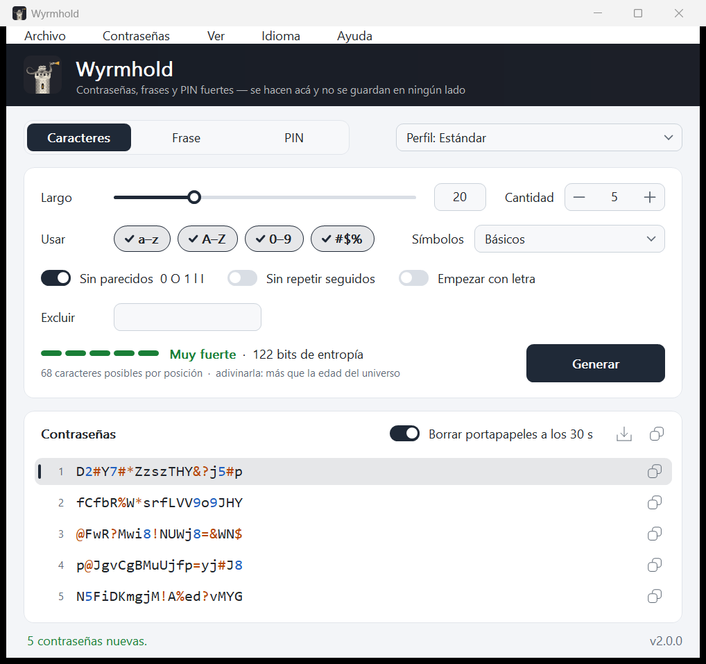

<p align="center"></p>

<h1 align="center">Forja</h1>
<p align="center"><b>Contraseñas, frases y PIN fuertes — se hacen en tu computadora y no se guardan en ningún lado.</b></p>

<p align="center"><a href="README.md">English</a> · <b>Español</b> · <a href="README.ja.md">日本語</a></p>

<p align="center"></p>

> **Solo para Windows 10/11 en x64 (Intel o AMD de 64 bits).** No hay versión para procesadores ARM.

En la *forja* el metal toma forma a golpes de martillo sobre el yunque, como acá cada contraseña sale del puro azar.
Hasta la versión 2.1 se llamaba Wyrmhold.

- **Tres tipos:** caracteres al azar (4–128), frases con la lista de 7.776 palabras de la EFF (3–12 palabras) y PIN.
- **Perfiles** para los casos de siempre, incluidos los sitios que no aceptan símbolos, los que aceptan solo
  `- _ .`, los de largo máximo corto, Wi-Fi y PIN. Juegos de símbolos: básicos, todos, mínimos o los tuyos;
  caracteres a excluir; sin parecidos, sin repetir seguidos, empezar con letra; PIN sin seguidos como 123.
- **Uniforme:** el azar sale de `BCryptGenRandom`; una contraseña que rompe una regla se sortea de nuevo, nunca
  se parcha, así que todas las válidas son igual de probables. La entropía que muestra es exacta, con todas las reglas.
- Copiar una o todas, o guardarlas en un archivo de texto. Lo copiado queda fuera del historial del portapapeles
  (Win+V) y de la nube, y **se borra a los 2 minutos** (de 10 s a 10 min en la ventana, o nunca) o apenas se cierra
  el programa — solo si el portapapeles sigue teniendo exactamente lo que puso Forja, así que lo que hayas copiado
  después no se toca. Ver [Portapapeles](#portapapeles).
- **Actualizaciones que se instalan solas:** Ayuda → Buscar actualizaciones, y una vez por día por su cuenta si
  decís que sí la primera vez que abrís Forja (se puede apagar). Una sola pregunta — Actualizar ahora, Ver
  novedades o Más tarde — y después se descarga el instalador solo si la versión publicada lleva la firma del autor,
  se verifica contra su `SHA256SUMS.txt` (si no coincide se borra y nunca se ejecuta), se instala en silencio con
  las mismas opciones y Forja vuelve a abrirse. Una copia portable solo ofrece abrir la página de descarga. Ver
  [Actualizaciones](#actualizaciones).
- **Accesible:** el Narrador y los otros lectores de pantalla nombran cada control, con el estado de los
  interruptores, las fichas y los modos, el valor del deslizador, las contraseñas de la lista y los menús, y leen
  la línea de estado cuando cambia. Nítido en cualquier pantalla: si la ventana pasa a una pantalla con otra
  escala, se vuelve a dibujar a esa escala.
- Inglés, japonés y español; tema claro, oscuro o como Windows y doce colores, que también pintan el ícono.
- **Instalador** en los tres idiomas, por usuario y sin permisos de administrador, con un desinstalador limpio.
  O portable: un único `forja.exe` estático con un `forja.ini` vacío al lado.
- Línea de comandos para scripts: `forja.exe /out:claves.txt [/mode:chars|words|pin] [/len:N] [/count:N] ...`

### Portapapeles

- **Borrar portapapeles a los** (junto a la lista) viene encendido, con **2 minutos**; el desplegable de al lado
  ofrece 10 s, 30 s, 1, 2, 5 y 10 minutos, y elegir un tiempo también enciende el borrado. Apagado, lo copiado
  queda hasta que se copie otra cosa.
- Se borra solo si el portapapeles sigue teniendo **exactamente** lo que puso Forja: Forja recuerda el número
  de secuencia del portapapeles y un SHA-256 del texto (nunca el texto). Lo que se copie después, por vos o por otro
  programa, no se toca; el mismo texto vuelto a poner por una herramienta de portapapeles sí se borra.
- **Si cerrás Forja antes de que pase el tiempo, lo copiado se borra en el acto** (de nuevo, solo si sigue siendo
  de Forja), y lo mismo al cerrar sesión o apagar. Con el borrado apagado, cerrar no toca lo copiado.
- Cada copia lleva los formatos que la dejan fuera del historial (Win+V), del portapapeles en la nube y de los
  monitores de portapapeles.
- Configuración, en `forja.ini`: `ClearClipboard=1|0` y `ClearSeconds=120` (de 5 a 3600). Solo para una sesión:
  `forja.exe /clearafter:90` (segundos), `/clearafter:5m` (minutos) o `/clearafter:off` — no se guarda.

### Actualizaciones

- **Ayuda → Buscar actualizaciones…** le pregunta a `api.github.com` por la última versión publicada; **Ayuda →
  Buscar actualizaciones todos los días** (`CheckUpdates=1|0` en `forja.ini`) lo hace solo, como mucho una vez por
  día. Solo se pide la versión: no se envía nada sobre vos ni tus contraseñas.
- La primera vez que abrís Forja (sin `CheckUpdates` en `forja.ini`, también si venís de la 3.0 o anterior) te
  pregunta una sola vez si querés que busque todos los días, antes de consultarle nada a GitHub. La respuesta se
  guarda; si cerrás la pregunta sin contestar no se guarda nada, esa vez no se busca y se vuelve a preguntar en el
  próximo arranque. Si lo abre el instalador después de una actualización, la búsqueda diaria sigue encendida,
  sin preguntar.
- Si la versión publicada es más nueva, una sola pregunta: **Actualizar ahora**, **Ver novedades** (abre la página
  de la versión) o **Más tarde**.
- **Actualizar ahora** comprueba primero que el `SHA256SUMS.txt` de la versión publicada lleve la firma del autor
  (`release.sig`, que se comprueba con dos claves que trae Forja); una versión sin firma válida no instala nada y
  solo se puede bajar a mano desde su página. Después descarga el instalador `Forja-Setup-VERSIÓN.exe` y compara
  el SHA-256; si no coincide, el archivo se borra y nunca se ejecuta. Después Forja se cierra (lo copiado que
  esperaba borrarse se borra), el instalador corre con `/VERYSILENT /SUPPRESSMSGBOXES /NORESTART`, conservando la
  carpeta, el idioma y las tareas elegidos antes, espera a que Forja haya terminado y lo vuelve a abrir.
- Una copia **portable** (no la que instaló el instalador) no puede actualizarse sola: ofrece abrir la página de descarga.
- Por eso cada versión publicada tiene que traer el instalador, un `SHA256SUMS.txt` (`hash  nombre del archivo` por
  línea) y su `release.sig`.

**Descarga:** el instalador está en [Releases](https://github.com/Gabriel-Castiglia/forja-windows/releases/latest).

**Versión para macOS:** <https://github.com/Gabriel-Castiglia/forja> (solo Apple silicon).

**Guías de uso:** [`docs/`](docs) — en inglés, japonés y español, en PDF y Word.

### Compilar

Hace falta MSYS2 con mingw-w64 GCC en `C:\msys64` (o la variable `MINGW` apuntando a su carpeta `bin`), e
Inno Setup 6 para el instalador:

```bat
build.bat
rem -> build\forja.exe
powershell -File tools\make_installer.ps1
rem -> out\Forja-Setup-<version>.exe
```

La versión se escribe solo en `src/version.h`; el programa, el instalador y las guías la leen de ahí.

Probado con: Windows 11 Pro x64, MSYS2 con mingw-w64 GCC 16.2.0 (paquete 16.2.0-6) y binutils (windres) 2.47 (2.47-4),
Inno Setup 6.7.3, Python 3.13.17 con python-docx 1.2.0 (guías), Pillow 12.3.0, numpy 2.5.4, scipy 1.18.1 y
opencv-python 5.0.0.93 (ícono e imágenes del instalador), LibreOffice 26.8.2.2 (guías a PDF).

El ícono sale de `assets/icon.svg` (en todos los colores, con la herramienta de íconos del autor) y las imágenes del
instalador las dibuja `tools/make_wizard.py`; el encabezado
con la lista de palabras, `tools/make_wordlist.py` a partir de `assets/eff_large_wordlist.txt`.

### Verificaciones

| Script | Qué prueba |
|---|---|
| `tools/run_checks.ps1` | Que el generador cumple las reglas, sobre varios cientos de miles de contraseñas. Antes calibra el verificador: un archivo correcto tiene que pasar y cinco copias estropeadas tienen que fallar. Después corre el autotest de `forja.exe` (abajo). |
| `forja.exe /selftest:informe.txt` | Unos cinco segundos, sin ventana: el borrado del portapapeles (se borra al pasar el tiempo, no toca una copia posterior de otro programa, sí borra exactamente el mismo texto, borra al salir, no borra nada con el borrado apagado, formatos que lo dejan fuera del historial), la configuración del portapapeles y `/clearafter` en un `.ini` descartable, y las funciones puras de la actualización (comparar versiones, buscar en `SHA256SUMS.txt`, el JSON de la versión publicada, SHA-256, la firma del autor). Guarda tu portapapeles antes y lo restaura después; nunca toca tu configuración. Código de salida = fallas. |
| `tools/check_options.py` | Cada opción (juegos de caracteres, exclusiones, sin repetir, primera letra, seguidos en el PIN, separadores de las frases) sobre miles de contraseñas, y la entropía exacta contra un cálculo independiente. Calibrado antes. |
| `tools/check_clipboard.ps1` | Lo mismo desde afuera, con la ventana real: una copia portable en una carpeta temporal con `/clearafter:5`; formatos de exclusión, borrado al pasar el tiempo, una copia posterior de otro programa que no se toca, borrado al salir, `/clearafter` que no se guarda. Correlo en una sesión interactiva (Windows PowerShell, `-STA`). |
| `tools/audit_sources.py` | Encabezado de copyright y licencia (GPL-2.0-only, SPDX) en cada archivo fuente, comentarios en inglés, finales de línea, la versión escrita solo en `src/version.h`, cada texto de la interfaz en los tres idiomas. |

Las guías las genera `tools/make_guide.py` (python-docx), con los colores del propio programa (leídos de
`src/theme.c`), y `tools/make_pdf.ps1` las pasa a PDF (con LibreOffice, o con Microsoft Word si LibreOffice no está
instalado).

---

## Licencia

Software libre bajo la **Licencia Pública General de GNU, versión 2 únicamente** (GPL-2.0-only), sin garantía — ver
[`LICENSE`](LICENSE).

© 2026 Gabriel Castiglia. C puro y la API Win32, sin código de terceros.
Palabras de las frases: la lista grande de la EFF, Electronic Frontier Foundation, CC BY 3.0 US (eff.org/dice).
Ícono: un yunque y un martillo dibujados para Forja (2026), bajo la GPL-2.0 como el resto.
