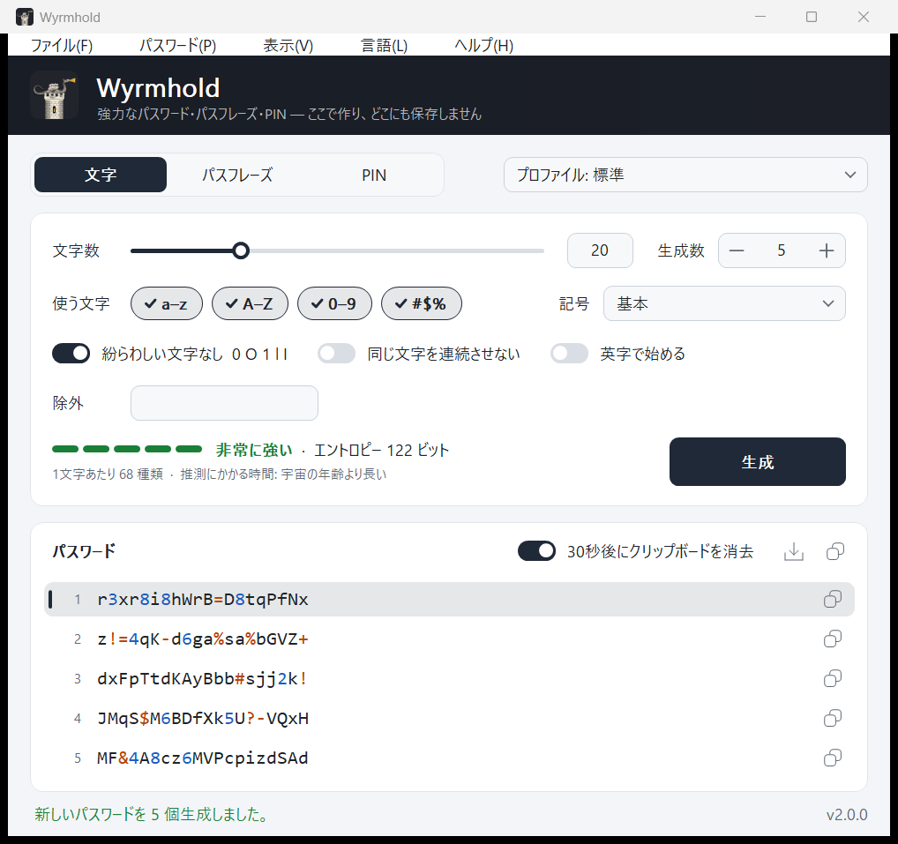

<p align="center"></p>

<h1 align="center">Forja</h1>
<p align="center"><b>強力なパスワード・パスフレーズ・PIN — このコンピューターで作り、どこにも保存しません。</b></p>

<p align="center"><a href="README.md">English</a> · <a href="README.es.md">Español</a> · <b>日本語</b></p>

<p align="center"></p>

> **x64(64 ビットの Intel / AMD)の Windows 10/11 専用です。** ARM プロセッサー用の版はありません。

Forja はスペイン語で「鍛冶場」。金床の上で槌を打って金属を形づくるように、ここでは一つひとつのパスワードが純粋な偶然から生まれます。バージョン 2.1 までは Wyrmhold という名前でした。

- **3 つの種類:** ランダムな文字(4〜128)、EFF の 7,776 語リストによるパスフレーズ(3〜12 単語)、PIN。
- **プロファイル:** 記号を受け付けないサイト、`- _ .` だけ受け付けるサイト、最大文字数が少ないサイト、Wi-Fi、PIN など。
  記号の組(基本・すべて・最小限・自分で指定)、除外する文字、紛らわしい文字なし、同じ文字を連続させない、英字で始める、123 のような連番のない PIN。
- **一様:** 乱数は `BCryptGenRandom`。規則に反するパスワードは修正せず引き直すため、有効なパスワードはすべて同じ確率です。
  表示されるエントロピーはすべての規則を含めた正確な値です。
- 1 つまたはすべてをコピー、またはテキストファイルに保存。コピーはクリップボード履歴(Win+V)とクラウドに残らず、**2 分後**(ウィンドウでは 10 秒〜10 分、またはオフ)またはプログラム終了時に消去されます。消去するのはクリップボードの中身が Forja の入れたものとまったく同じ場合だけなので、後からコピーしたものには手を触れません。[クリップボード](#クリップボード)を参照してください。
- **自動でインストールされる更新:** 「ヘルプ」→「更新の確認」、および 1 日 1 回の自動確認(初回起動時に、使うかどうかを一度だけ尋ねます。後からオフにもできます)。「今すぐ更新」「更新内容を見る」「後で」の質問が 1 回だけ表示され、その後はリリースに作者の署名がある場合に限り、セットアップのダウンロード、リリースの `SHA256SUMS.txt` との照合(一致しないファイルは削除され、実行されません)、同じ設定での自動インストール、Forja の再起動まで自動で行われます。ポータブル版はダウンロードページを開くことだけを提案します。[更新](#更新)を参照してください。
- **アクセシビリティ:** ナレーターなどのスクリーンリーダーが、すべてのコントロールの名前、スイッチ・チップ・モードの状態、スライダーの値、一覧のパスワード、メニューを読み上げ、状態表示の変化も読み上げます。表示倍率の異なる画面にウィンドウを移すと、その倍率で描き直されるため、どの画面でもくっきり表示されます。
- 英語・日本語・スペイン語。ライト・ダーク・Windows に合わせるテーマと 12 色(アイコンの色も変わります)。
- 3 か国語の**セットアップ**(ユーザー単位、管理者権限不要、きれいに削除できるアンインストーラー)。またはポータブル:
  静的リンクの `forja.exe` 1 つと、その横に空の `forja.ini`。
- スクリプト用のコマンドライン: `forja.exe /out:passwords.txt [/mode:chars|words|pin] [/len:N] [/count:N] ...`

### クリップボード

- 一覧の横の**「クリップボードを自動消去」**は既定でオン、時間は **2 分**です。横のドロップダウンで 10 秒・30 秒・1 分・2 分・5 分・10 分を選べ、時間を選ぶと自動消去もオンになります。オフにすると、ほかのものをコピーするまで残ります。
- 消去するのは、クリップボードの中身が Forja の入れたものと**まったく同じ**場合だけです。Forja はクリップボードのシーケンス番号とテキストの SHA-256 を覚えておき、テキストそのものは保持しません。後からあなたやほかのプログラムがコピーしたものには手を触れません。クリップボードツールが同じテキストを戻した場合は消去します。
- **時間がたつ前に Forja を閉じると、コピーはその場で消去されます**(これも Forja のものが残っている場合だけ)。サインアウトやシャットダウンのときも同じです。自動消去がオフなら、閉じてもコピーは残ります。
- コピーには、クリップボード履歴(Win+V)、クラウドクリップボード、クリップボード監視ツールから除外するための形式が必ず付きます。
- 設定は `forja.ini` の `ClearClipboard=1|0` と `ClearSeconds=120`(5〜3600)。そのセッションだけなら
  `forja.exe /clearafter:90`(秒)、`/clearafter:5m`(分)、`/clearafter:off`(保存されません)。

### 更新

- **「ヘルプ」→「更新の確認…」**で `api.github.com` に最新のリリースを問い合わせます。**「ヘルプ」→「毎日自動で更新を確認」**(`forja.ini` の `CheckUpdates=1|0`)がオンなら、1 日 1 回まで自動で確認します。問い合わせるのはバージョンだけで、あなたやパスワードに関する情報は何も送られません。
- 初回起動時(`forja.ini` にまだ `CheckUpdates` がない場合。3.0 以前からの更新も含みます)、GitHub に何かを問い合わせる前に、毎日確認するかどうかを一度だけ尋ねます。答えは保存されます。答えずに閉じた場合は何も保存せず、その回は確認せず、次の起動時にもう一度尋ねます。更新後にセットアップが起動した場合は、尋ねずに毎日の確認をオンのままにします。
- 新しいリリースがあれば、**「今すぐ更新」**、**「更新内容を見る」**(リリースのページを開きます)、**「後で」**の質問が 1 回だけ表示されます。
- **「今すぐ更新」**は、まずリリースの `SHA256SUMS.txt` に作者の署名(`release.sig`、Forja に組み込まれた 2 つの鍵で確認)があることを確かめます。有効な署名がないリリースは何もインストールせず、ページから手動でダウンロードするしかありません。続いてセットアップ `Forja-Setup-バージョン.exe` をダウンロードして SHA-256 を照合し、一致しなければファイルを削除して、実行することはありません。一致すれば Forja を閉じ(消去待ちのコピーは消去されます)、セットアップが `/VERYSILENT /SUPPRESSMSGBOXES /NORESTART` で、前回選んだインストール先・言語・タスクのまま実行され、Forja の終了を待ってからもう一度起動します。
- **ポータブル版**(セットアップでインストールしたものではないコピー)は自動では更新できず、ダウンロードページを開くことを提案します。
- そのため、リリースにはセットアップ、`SHA256SUMS.txt`(1 行に `ハッシュ  ファイル名`)、その `release.sig` が必要です。

**ダウンロード:** セットアップは [Releases](https://github.com/Gabriel-Castiglia/forja-windows/releases/latest) にあります。

**macOS 版:** <https://github.com/Gabriel-Castiglia/forja>(Apple silicon のみ)。

**ユーザーガイド:** [`docs/`](docs) — 英語・日本語・スペイン語(PDF と Word)。

### ビルド

`C:\msys64` に MSYS2 の mingw-w64 GCC(または、その `bin` フォルダーを指す環境変数 `MINGW`)、セットアップには Inno Setup 6 が必要です:

```bat
build.bat
rem -> build\forja.exe
powershell -File tools\make_installer.ps1
rem -> out\Forja-Setup-<version>.exe
```

バージョンは `src/version.h` にだけ書かれています。プログラム、セットアップ、ガイドはそこから読み取ります。

動作確認環境: Windows 11 Pro x64、MSYS2 の mingw-w64 GCC 16.2.0(パッケージ 16.2.0-6)と binutils(windres)2.47(2.47-4)、
Inno Setup 6.7.3、Python 3.13.17 と python-docx 1.2.0(ガイド)、Pillow 12.3.0、numpy 2.5.4、scipy 1.18.1、
opencv-python 5.0.0.93(アイコンとセットアップの画像)、LibreOffice 26.8.2.2(ガイドの PDF 化)。

アイコンとセットアップの画像は `tools/make_icon.py` と `tools/make_wizard.py` が描き、単語リストのヘッダーは
`tools/make_wordlist.py` が `assets/eff_large_wordlist.txt` から作ります。

### 検証

| スクリプト | 確認すること |
|---|---|
| `tools/run_checks.ps1` | 数十万個のパスワードで、生成器が規則を守っていること。最初に検査器を校正します(正しいファイルは合格し、1 か所ずつ壊した 5 つのコピーは不合格になること)。その後 `forja.exe` のセルフテスト(下記)を実行します。 |
| `forja.exe /selftest:report.txt` | 約 5 秒、ウィンドウなし: クリップボードの自動消去(時間がたつと消去、後からほかのプログラムがコピーしたものは残す、まったく同じテキストは消去、終了時に消去、自動消去オフでは何も消さない、履歴から除外する形式)、使い捨ての `.ini` でのクリップボードの設定と `/clearafter`、更新の純粋な関数(バージョン比較、`SHA256SUMS.txt` の検索、リリースの JSON、SHA-256、作者の署名)。あなたのクリップボードは最初に保存して最後に戻し、設定には一切触れません。終了コード = 失敗の数。 |
| `tools/check_options.py` | すべてのオプション(文字の組、除外、繰り返しなし、先頭の英字、PIN の連番、パスフレーズの区切り)を数千個のパスワードで確認し、正確なエントロピーを独立した計算と照合します。最初に校正します。 |
| `tools/check_clipboard.ps1` | 同じことを外側から、実際のウィンドウで確認します: 一時フォルダーのポータブル版を `/clearafter:5` で起動し、除外の形式、時間後の消去、後からほかのプログラムがコピーしたものを残すこと、終了時の消去、`/clearafter` が保存されないこと。対話型セッション(Windows PowerShell、`-STA`)で実行してください。 |
| `tools/audit_sources.py` | すべてのソースファイルの著作権・ライセンスのヘッダー(GPL-2.0-only、SPDX)、英語のコメント、改行コード、バージョンが `src/version.h` にだけあること、インターフェースのすべての文字列が 3 か国語にあること。 |

ガイドは `tools/make_guide.py`(python-docx)が、プログラム自身の配色(`src/theme.c` から読み取り)で作り、
`tools/make_pdf.ps1` が PDF に変換します(LibreOffice、インストールされていなければ Microsoft Word)。

---

## ライセンス

**GNU 一般公衆利用許諾書 バージョン 2 のみ**(GPL-2.0-only)のもとで配布されるフリーソフトウェアです。無保証です。[`LICENSE`](LICENSE) を参照してください。

© 2026 Gabriel Castiglia. C と Win32 API のみ、サードパーティのコードはありません。
パスフレーズの単語: Electronic Frontier Foundation の EFF large word list(CC BY 3.0 US、eff.org/dice)。
アイコン: ロンドンの鍛冶屋 Elwell and Taylor の商用カード(1766 年ごろ、大英博物館、パブリックドメイン)の金床と槌。
