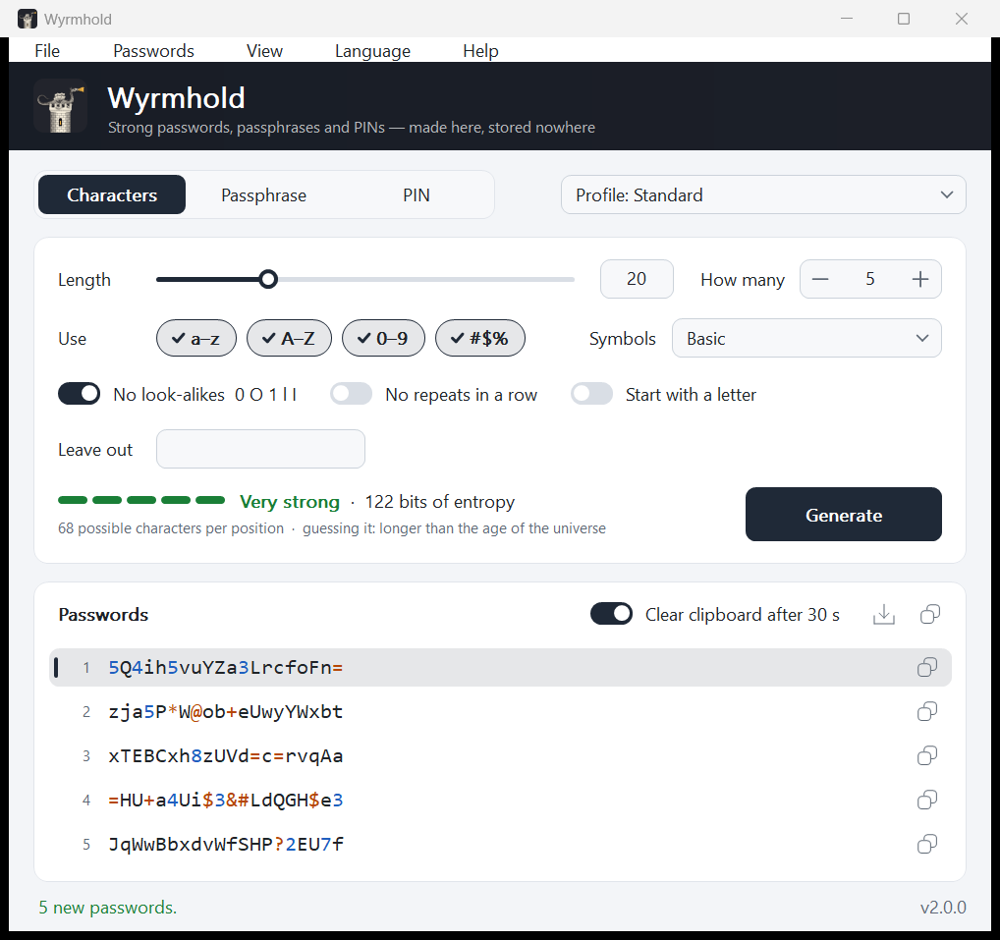

<p align="center"></p>

<h1 align="center">Random Password Generator</h1>
<p align="center"><b>Strong random passwords, one click to copy, nothing stored.</b><br>
<i>Contraseñas aleatorias fuertes, se copian con un clic, no se guarda nada.</i><br>
<i>強力なランダムパスワードをワンクリックでコピー、何も保存しません。</i></p>

<p align="center"></p>

[English](#english) · [Español](#español) · [日本語](#日本語)

---

## English

A small Windows program that makes strong random passwords, for example to protect a zip, 7z or rar file sent
by email. It follows the rules of `password_gen.py`, the original Python script, and adds a window.

- **Portable:** a single static `randompassgen.exe` (about 270 KB). Nothing to install, no runtime, no registry.
- Length 4–128 (20 by default), 1–50 passwords at a time, option to avoid ambiguous characters (`0 O 1 l I`).
- At least one lowercase letter, uppercase letter, digit and symbol in every password; randomness from
  `BCryptGenRandom` with uniform (rejection) sampling.
- Strength line with the entropy in bits; digits in blue and symbols in amber so a password is easy to read back.
- Copy one or all, or save them to a text file. Copies are kept out of the clipboard history (Win+V) and the
  cloud clipboard, and wiped after 30 seconds or when the program closes.
- English, Japanese and Spanish; light and dark theme following Windows; Help and About windows.
- Command line for scripts: `randompassgen.exe /out:passwords.txt [/len:N] [/count:N] [/ambiguous]`.

**User guides:** [`docs/`](docs) — English, Japanese and Spanish, in PDF and Word.

### Build

Needs MSYS2 with mingw-w64 GCC in `C:\msys64` (or set `MINGW` to its `bin` folder):

```bat
build.bat
rem -> build\randompassgen.exe
```

### Checks

| Script | What it proves |
|---|---|
| `tools/run_checks.ps1` | The generator follows the rules, over several hundred thousand passwords. The checker is calibrated first: a correct file must pass and five spoiled copies must fail. |
| `tools/check_clipboard.ps1` | Clipboard exclusion formats, wipe after 30 s, a later copy by another program is left alone, wipe on exit. Run it in an interactive session. |
| `tools/audit_sources.py` | Author line in every source file, comments in English, line endings, the same version in all places, every interface text in the three languages. |

The guides are generated by `tools/make_guide.py` (python-docx) and printed to PDF by `tools/make_pdf.ps1` (Word).

---

## Español

Un programa chico para Windows que genera contraseñas aleatorias fuertes, por ejemplo para proteger un zip, 7z
o rar que se manda por correo. Sigue las reglas de `password_gen.py`, el script original en Python, y le suma una
ventana.

- **Portable:** un único `randompassgen.exe` estático (unos 270 KB). No se instala, no pide runtime, no toca el registro.
- Largo de 4 a 128 (20 por defecto), de 1 a 50 contraseñas por vez, opción para evitar caracteres ambiguos (`0 O 1 l I`).
- Cada contraseña tiene al menos una minúscula, una mayúscula, un dígito y un símbolo; el azar sale de
  `BCryptGenRandom` con muestreo uniforme (por rechazo).
- Línea de fuerza con la entropía en bits; dígitos en azul y símbolos en ámbar para leerla sin errores.
- Copiar una o todas, o guardarlas en un archivo de texto. Lo copiado queda fuera del historial del portapapeles
  (Win+V) y de la nube, y se borra a los 30 segundos o al cerrar el programa.
- Inglés, japonés y español; tema claro y oscuro según Windows; ventanas de Ayuda y Acerca de.
- Línea de comandos para scripts: `randompassgen.exe /out:claves.txt [/len:N] [/count:N] [/ambiguous]`.

**Guías de uso:** [`docs/`](docs) — en inglés, japonés y español, en PDF y Word.

### Compilar

Hace falta MSYS2 con mingw-w64 GCC en `C:\msys64` (o la variable `MINGW` apuntando a su carpeta `bin`):

```bat
build.bat
rem -> build\randompassgen.exe
```

### Verificaciones

| Script | Qué demuestra |
|---|---|
| `tools/run_checks.ps1` | Que el generador cumple las reglas, con cientos de miles de contraseñas. Antes se calibra el verificador: un archivo correcto tiene que pasar y cinco copias adulteradas tienen que fallar. |
| `tools/check_clipboard.ps1` | Formatos de exclusión del portapapeles, borrado a los 30 s, respeta una copia posterior de otro programa, borrado al salir. Se corre en una sesión interactiva. |
| `tools/audit_sources.py` | Línea de autor en cada fuente, comentarios en inglés, finales de línea, la misma versión en todos lados, todos los textos de la interfaz en los tres idiomas. |

Las guías las genera `tools/make_guide.py` (python-docx) y las pasa a PDF `tools/make_pdf.ps1` (Word).

---

## 日本語

強力なランダムパスワードを生成する Windows 用の小さなプログラムです。たとえばメールで送る zip・7z・rar
ファイルの保護に使えます。元の Python スクリプト `password_gen.py` と同じ規則に従い、ウィンドウを追加しました。

- **ポータブル:** 静的リンクの `randompassgen.exe` 1 ファイルのみ(約 270 KB)。インストール不要、ランタイム不要、レジストリも使いません。
- 長さ 4〜128 文字(既定 20)、一度に 1〜50 個、紛らわしい文字(`0 O 1 l I`)を除外するオプション。
- 各パスワードに小文字・大文字・数字・記号を 1 文字以上含みます。乱数は `BCryptGenRandom`、棄却法による一様サンプリング。
- エントロピー(ビット)を示す強度表示。数字は青、記号は琥珀色で表示し、読み間違いを防ぎます。
- 1 つまたは全部をコピー、またはテキストファイルに保存。コピーはクリップボード履歴(Win+V)とクラウドに残らず、30 秒後またはプログラム終了時に消去されます。
- 英語・日本語・スペイン語。Windows に合わせたライト/ダークテーマ。ヘルプとバージョン情報。
- スクリプト用コマンドライン: `randompassgen.exe /out:passwords.txt [/len:N] [/count:N] [/ambiguous]`。

**ユーザーガイド:** [`docs/`](docs) — 英語・日本語・スペイン語(PDF と Word)。

### ビルド

MSYS2 の mingw-w64 GCC を `C:\msys64` にインストールしておきます(または環境変数 `MINGW` にその `bin` フォルダーを指定):

```bat
build.bat
rem -> build\randompassgen.exe
```

検証スクリプト(`tools/run_checks.ps1`、`tools/check_clipboard.ps1`、`tools/audit_sources.py`)の内容は英語版の表を参照してください。

---

## License / Licencia / ライセンス

Free software under the **GNU General Public License, version 2 only** (GPL-2.0-only), with no warranty — see [`LICENSE`](LICENSE).
Software libre bajo la **GPL versión 2 únicamente** (GPL-2.0-only), sin garantía. GNU GPL バージョン 2 のみ(GPL-2.0-only)、無保証。

© 2026 Gabriel Castiglia. No third-party code: plain C and the Win32 API.
